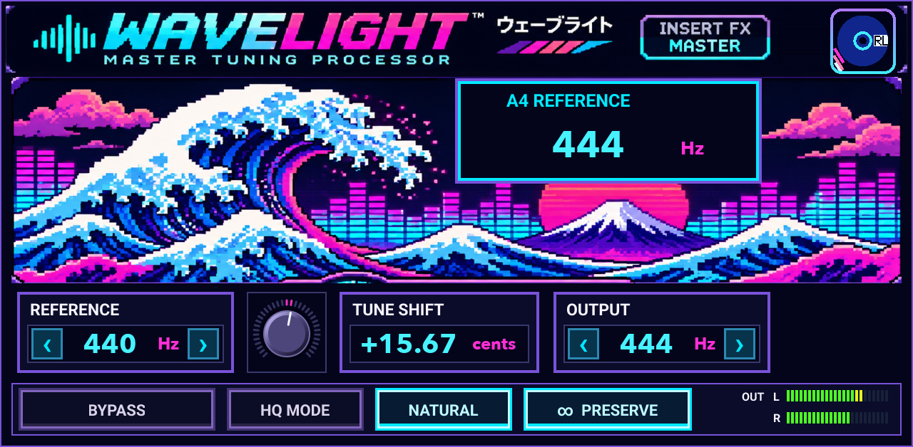

# Wavelight

Wavelight is a stereo master tuning insert. It shifts a finished mix by a fixed musical interval and leaves the tempo and the length of the audio alone.

The default interval takes A4 from 440 Hz to 444 Hz. That is 15.67 cents (`1200 × log2(444 / 440)`). A 220 Hz tone comes out at 222 Hz. Reference is the A4 the music was tuned to. Tune is the shift in cents. The large readout is reference times that ratio, so 440 Hz and +15.67 cents reads 444 Hz.

The wave is artwork. It moves with the music. The tuning is the fixed interval.

## Controls

| Control | What it does |
| --- | --- |
| Reference | The A4 the incoming music is tuned to, from 420 Hz to 480 Hz. Default 440 Hz. |
| Tune | The shift, from −200 cents to +200 cents. Default +15.67 cents. |
| Output | The resulting A4, in hertz. The arrows step it by 1 Hz. |
| Bypass | Crossfades to a dry copy delayed by the same amount as the tuned path, so the timing stays put. |
| Level | Output trim, from −24 dB to +12 dB. |

Programs are **444 Hz**, **Unity**, and **432 Hz**. Unity is no shift. 432 Hz is 440 Hz moved down to 432 Hz.

## Where it runs

On Akai Professional MPC standalone it is a master insert, for MPC OS 3.10.1 and later. The package is installed with Open MPC. Save the project before installing. The installer restarts the MPC application.

On macOS it is a VST® 3 plug-in, an Audio Unit, and an Audio Unit app extension (AUv3). The minimum system is macOS 12. The manufacturer code is Wylt and the plug-in code is WY1S.

Manufacturer and plug-in name are both Wavelight.

## Download

[Wavelight 1.0.0 for macOS](https://github.com/asearan/Wavelight/releases/download/v1.0.0/Wavelight-1.0.0-macOS.pkg) is a signed installer for Apple silicon. It needs macOS 12 or later. The installer adds the VST® 3 plug-in, the Audio Unit, and the Wavelight app. Open the app once so macOS registers the Audio Unit app extension.

The package is signed with an Apple Developer ID certificate. This build is not notarized, so the first time you open the downloaded installer, macOS asks you to approve it.

## Trademarks

Wavelight is an independent product. The names below identify the instruments and formats it runs on. The header mark on the screen is the Retroloop logo.

Akai Professional and MPC are trademarks of inMusic Brands, Inc., registered in the U.S. and other countries.

VST® is a registered trademark of Steinberg Media Technologies GmbH.

macOS and Audio Units are trademarks of Apple Inc., registered in the U.S. and other countries.

JUCE is a trademark of Raw Material Software Limited. The macOS plug-in is built with JUCE 8.

The VST Compatible logo is Steinberg’s artwork, shown unaltered. Wavelight does not use the Akai Professional logo.

All other product names, company names, and marks belong to their respective owners.

Copyright © Wavelight. All rights reserved.
